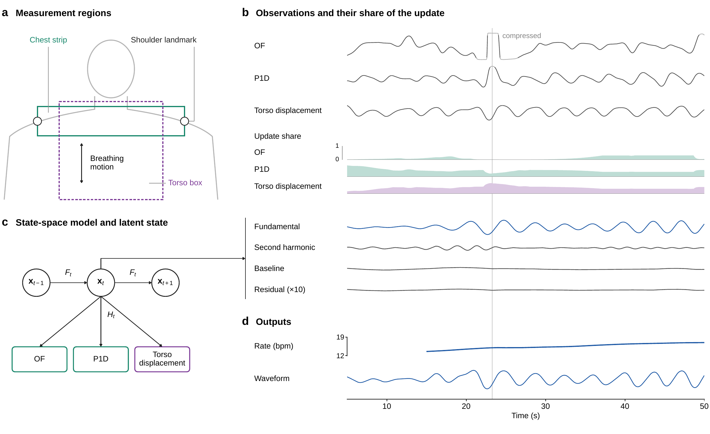

<h1 align="center">Video-Based Respiratory Rate Estimation via<br>Reliability-Weighted Multichannel State-Space Fusion</h1>

<p align="center">
Young-Jae Cho<sup>1,†</sup>, Do-Yup Kim<sup>2,†</sup>, Dae-Yeol Kim<sup>1,&#42;</sup>, Youngjun Kim<sup>3,&#42;</sup><br>
<sup>1</sup>University of Ulsan &nbsp; <sup>2</sup>Incheon National University &nbsp; <sup>3</sup>Changwon National University<br>
<sup>†</sup>Equal contribution &nbsp; <sup>&#42;</sup>Corresponding authors<br>
<i>Scientific Reports</i>, in revision
</p>

## What the Code Computes

Breathing moves the upper torso by about a pixel in an ordinary video, and that movement reaches the camera
mixed with head and posture motion, changes of illumination, and sensor noise. This code estimates the respiratory
rate and a respiratory waveform from such video without a contact sensor. It reads the movement through nine
observations, each a different measurement of the same displacement, and estimates one latent breathing oscillation
from all of them with a state-space filter, PARH-OSSM, which weights each observation by how much of that
oscillation it appears to carry.

<br>
<p align="center"></p>
<p align="center"><sub><b>Figure 1.</b> PARH-OSSM: the nine video-derived observations, the reliability-weighted
observation law, the state-space model, and the separate rate and waveform outputs.</sub></p>
<br>

1. **Observations.** Each observation reads the movement through a different image cue and so adds its own error.
   Optical flow (OF) measures the vertical velocity of the chest texture, and the OF bridge integrates it into a
   displacement, which drifts. The difference of frames (DoF) counts the pixels whose brightness changes, whatever
   the direction of motion, so it also responds to changes of light; the DoF bridge gives the count the sign of the
   motion. The one-dimensional profile routes (P1D linear, quadratic, and cubic) measure the vertical shift of a
   row-intensity profile between frames and differ only in how they refine the correlation peak, and P1D consensus
   combines them. These eight are measured in a chest region placed from the shoulder landmarks. Torso
   displacement, the ninth, is the shift of a box below the face against a keyframe renewed every second, so its errors accumulate
   at each renewal. Head and posture motion enter all nine. Before filtering, every observation is aligned to one
   anchor observation, which removes the quarter cycle by which a velocity leads a displacement.
2. **Estimation.** Each observation is first tracked alone by an oscillator Kalman filter, OSSM-KF, which is also
   the single-observation method of the article. PARH-OSSM then filters the nine together as noisy views of one
   state: a breathing oscillation, its second harmonic for the asymmetry of inhalation and exhalation, a baseline
   drift, and an aperiodic residual, so that drift and irregular motion go to their own components rather than to
   the oscillation. The observation law sets how much each observation counts. The measurement variance of each
   observation, estimated from its innovations, is divided by a trust computed at each frame from the quality of
   those innovations, the agreement between observations in rate and phase, and target observability, which
   scores how clearly the window shows one respiratory rate. The variances of all observations rise together
   when that rate is ambiguous, and P1D quadratic and cubic, nearly the same measurement, count as one together. The Kalman filter and the
   Rauch–Tung–Striebel smoother run with these variances, and the waveform is read from the smoothed state. The
   rate combines the phase rate of the smoothed oscillation with a readout of the OSSM-KF tracks within the OF,
   DoF, and P1D families, weighted by reliability priors of each family and corrected by a posterior over
   candidate rates. Reliability thus enters twice, as the trust of each observation in the filter and as the
   prior of each family in the readout; both are computed from the video observations alone, and no step reads
   the respiratory belt. Table 3 of the article adds these parts one at a time: the multichannel filter, the
   readout, the observation law, target observability and signal quality, and the rate posterior, which
   completes PARH-OSSM. Three controls each remove one use of reliability and keep everything else:
   `equal_filter` replaces the trust of each observation by its mean over the observations at the same frame,
   `equal_readout` gives every family the mean of the family priors in each window, and `shuffled_readout`
   permutes the windows of each family's priors within the trial.
3. **Evaluation.** The rate is scored in 30-s windows under three definitions of the belt's rate (Hilbert, Welch,
   and breath count), because a method scores best under the definition that shares its estimator. It is compared
   with methods that read the same nine observations and with a constant predictor that outputs the typical rate
   of the cohort, which shows how much of a low error comes from staying near that rate; the slope of the
   trial-mean estimate on the trial-mean reference shows whether a method follows the differences in rate between
   trials. The waveform is scored by its concordance correlation coefficient (CCC) with the belt after a shift of
   up to ±2 s. Two nulls bound that agreement: the belts of other participants give the agreement expected by
   chance, and phase-randomized copies of the trial's own belt keep its rate and change only the timing of its
   breaths. COHFACE was used to build the method. MAHNOB-HCI participants were split into 9 development and 18
   test participants, and the test participants were scored once, after the method was fixed, in six
   confirmatory comparisons: PARH-OSSM against the constant predictor and against the submitted version of the
   method, which reads the eight chest observations, under each reference definition, corrected together for
   multiple testing. The MAHNOB-HCI belt recording is longer than the video and does not store where the video
   lies in it, so the reference starts at the stimulus onset, the position the development participants
   supported, and every MAHNOB-HCI result is also computed with the reference ending with the recording.

## Layout

The folders follow the computation, from video to the reported tables.

```
observations/   video → chest region and torso box → the nine observations
estimate/       OSSM-KF, PARH-OSSM, reliability priors, Table 3 stages, controls
evaluation/     belt references, window rates, statistics, waveform agreement, table rows
figures/        the figure scripts of the article
configs/        extraction settings of the reported COHFACE and MAHNOB-HCI runs
tests/          tests that pin the filters, the reference rates, and the controls
```

| In the article | Code |
|---|---|
| Chest observations | `observations/chest_roi.py`, `chest_motion.py`, `observation_signals.py` |
| Torso displacement | `observations/torso_shift_cache.py`, `estimate/merge_torso_rows.py` |
| OSSM-KF | `estimate/ossm_kf.py` |
| State-space model, observation law | `estimate/parh_ossm.py` |
| Anchor alignment, readout, observability, rate posterior | `estimate/multichannel_fusion.py` |
| Reliability priors | `estimate/reliability_priors.py` |
| Stages (Table 3), controls | `estimate/materialize.sh`, one run each |
| Belt references | `evaluation/belt_reference.py`, `rate_tracks.py` |
| Onset placement, MAHNOB-HCI | `evaluation/onset_reference.py`, `onset_alignment_waveform.py` |
| Sessions and split, MAHNOB-HCI | `evaluation/mahnob_common488_sessions.txt`, `mahnob_subject_split.csv` |
| Tables 2 and 3, constant predictor | `evaluation/main_tables.sh`, `main_tables.py` |
| Table 4, waveform agreement | `evaluation/bounded_lag_waveform.py`, `waveform_table.py` |
| Waveform nulls | `evaluation/phase_randomized_null.py` |
| Figure 2 | `figures/case_figure.py` |
| Confirmatory tests | `evaluation/confirmatory_test.py`, `mahnob_test_scores.sh` |
| Agreement across trials | `evaluation/rate_agreement.py`, `stage_slopes.py`, `observation_track_slope.py` |
| Agreement figures | `figures/rate_agreement_figure.py` |
| Error under motion | `evaluation/head_motion.py`, `motion_tertiles.py`, `motion_perturbation.sh` |
| Perturbation scale | `evaluation/torso_displacement_rms.py` |
| Supplementary tables | `evaluation/cohface_scores.sh`, `supplementary_tables.py`, `parameter_table.py` |

The stored records name the observations `of_farneback`, `of_disp_bridge`, `dof`, `dof_disp_bridge`,
`profile1d_linear`, `profile1d_quadratic`, `profile1d_cubic`, `profile1d_consensus`, and `torso_shift`, in the
order of item 1. A row ending in `__kfstd` holds the OSSM-KF track of one observation, and a row ending in
`__parh_ossm` the PARH filter run on that observation alone.

## Running

The code runs on Python 3.10 with the packages in `requirements.txt`. COHFACE
(<https://www.idiap.ch/en/scientific-research/data/cohface>) and MAHNOB-HCI (<https://mahnob-db.eu/>) are obtained
from their providers under their access terms and are not redistributed here. Commands run from the repository
root, and each `<...>` is a folder of your choice. The COHFACE and MAHNOB-HCI steps give the rows of Tables 2 and
3; the steps after them give the reliability controls and family exclusions, the confirmatory tests on the
MAHNOB-HCI test participants, Table 4, and the Supplementary tables.

### COHFACE

The runs read `data.cfr.avi`, a copy of each COHFACE `data.avi` at a constant 20 frames per second, placed beside
it. The reported copies were made with ffmpeg 6.1 under settings that were not recorded;
`ffmpeg -i data.avi -vsync cfr -r 20 -c:v mpeg4 -q:v 2 data.cfr.avi` makes a copy of the same frame rate and codec,
though not a byte-identical one.

1. Extract the nine observations from the videos:
   ```
   python observations/run_shards.py --dataset COHFACE --dataset-root <COHFACE folder> \
       --config configs/cohface_first_frame_roi.json --work <cohface dir> --shards 8
   ```
2. Copy the eight chest observations into a second bank, the input of the chest-only row of Table 2, and compute
   the reliability priors of both banks:
   ```
   python estimate/leave_one_out_data.py <cohface dir>/data <cohface chest dir>/data no_torso
   for bank in <cohface dir> <cohface chest dir>; do
       python estimate/reliability_priors.py --data-dir $bank/data --dataset-label COHFACE \
           --out-edge $bank/edges.csv --out-group $bank/group.csv \
           --out-summary $bank/summary.csv \
           --window-sec 30 --window-stride-sec 10 --jobs 8
   done
   ```
3. Run PARH-OSSM (`frozen`), the four stages of Table 3 before it, and PARH-OSSM on the chest bank:
   ```
   for run in frozen plain_multichannel readout observation_law observability; do
       estimate/materialize.sh $run <cohface dir>/data <cohface dir>/group.csv \
           <cohface runs>/$run 8
   done
   estimate/materialize.sh frozen <cohface chest dir>/data <cohface chest dir>/group.csv \
       <cohface runs>/chest_only 8
   ```
4. Compute the window rates, those of the methods without a filter (`bank_rates.sh`), and the table rows; the `-`
   stands for the MAHNOB-HCI folder, which COHFACE does not use:
   ```
   evaluation/window_rates.sh cohface <cohface dir>/data <cohface runs> <records> 8 - \
       frozen plain_multichannel readout observation_law observability chest_only
   evaluation/bank_rates.sh cohface <cohface dir>/data <records> 8
   evaluation/main_tables.sh <records> cohface > cohface_table_rows.tex
   ```

### MAHNOB-HCI

MAHNOB-HCI differs in three ways. Its 488 sessions with all eight chest observations are used
(`evaluation/mahnob_common488_sessions.txt`), and the torso displacement is extracted on its own and appended to
them as the ninth observation. The chest-only row of Table 2 is the submitted method itself, which reads the
reliability priors stored with the submitted analysis (`estimate/submitted_reliability_priors.csv.gz`); they were
computed from observation files that were not kept, so they cannot be recomputed. The belt is read under two
placements, ending with the recording and starting at the stimulus onset, the primary one, and `window_rates.sh`
writes both when it is given the MAHNOB-HCI folder.

1. Extract the eight chest observations, then the torso displacement, and append it to them:
   ```
   python observations/run_shards.py --dataset MAHNOB --dataset-root <MAHNOB-HCI folder> \
       --config configs/mahnob.json --work <mahnob dir> --shards 8 \
       --trials evaluation/mahnob_common488_sessions.txt
   python observations/torso_shift_cache.py MAHNOB <MAHNOB-HCI folder> \
       evaluation/mahnob_subject_split.csv <torso cache> 8
   python observations/torso_config.py configs/mahnob.json <torso dir>/config.json
   python observations/run_shards.py --dataset MAHNOB --dataset-root <MAHNOB-HCI folder> \
       --config <torso dir>/config.json --work <torso dir> --shards 8 \
       --trials evaluation/mahnob_common488_sessions.txt --torso-cache <torso cache>
   python estimate/merge_torso_rows.py <mahnob dir>/data <torso dir>/data <mahnob bank>/data
   ```
2. Compute the reliability priors of the nine observations:
   ```
   python estimate/reliability_priors.py --data-dir <mahnob bank>/data \
       --dataset-label MAHNOB --out-edge <mahnob bank>/edges.csv \
       --out-group <mahnob bank>/group.csv --out-summary <mahnob bank>/summary.csv \
       --window-sec 30 --window-stride-sec 10 --jobs 8
   ```
3. Run PARH-OSSM, the four stages before it, and the submitted method (`w2`) on the eight chest observations:
   ```
   for run in frozen plain_multichannel readout observation_law observability; do
       estimate/materialize.sh $run <mahnob bank>/data <mahnob bank>/group.csv \
           <mahnob runs>/$run 8
   done
   estimate/materialize.sh frozen <mahnob dir>/data \
       estimate/submitted_reliability_priors.csv.gz <mahnob runs>/w2 8
   ```
4. Compute the window rates under both placements, the rates without a filter, and the table rows:
   ```
   evaluation/window_rates.sh mahnob <mahnob dir>/data <mahnob runs> <records> 8 \
       <MAHNOB-HCI folder> frozen plain_multichannel readout observation_law observability w2
   evaluation/bank_rates.sh mahnob <mahnob bank>/data <records> 8
   evaluation/main_tables.sh <records> mahnob > mahnob_table_rows.tex
   ```

### Controls, tests, and the Supplementary

The reliability controls and the family exclusions run on the nine observations of each dataset with their
priors; each exclusion (`no_*`) copies the bank without those observations. `mahnob_test_scores.sh` then runs the
confirmatory tests on the MAHNOB-HCI test participants and writes the Supplementary tables of both datasets.

1. Run the controls and exclusions, and compute their window rates:
   ```
   variants="equal_readout shuffled_readout equal_filter no_torso no_of no_dof no_p1d
             no_bridges no_p1d_cubic no_p1d_consensus"
   for run in $variants; do
       estimate/materialize.sh $run <cohface dir>/data <cohface dir>/group.csv \
           <cohface runs>/$run 8
       estimate/materialize.sh $run <mahnob bank>/data <mahnob bank>/group.csv \
           <mahnob runs>/$run 8
   done
   evaluation/window_rates.sh cohface <cohface dir>/data <cohface runs> <records> 8 - \
       $variants
   evaluation/window_rates.sh mahnob <mahnob dir>/data <mahnob runs> <records> 8 \
       <MAHNOB-HCI folder> $variants
   ```
2. Measure the head motion of every trial, and run the frozen method on the COHFACE videos with controlled
   translation, rotation, and brightness changes:
   ```
   python evaluation/head_motion.py <COHFACE folder> <MAHNOB-HCI folder> <face tracks> 8 \
       <records>/cohface_frozen_window_rates_three_references.csv \
       <records>/mahnob_frozen_window_rates_three_references.csv \
       > <records>/head_motion_trials.csv
   evaluation/motion_perturbation.sh <COHFACE folder> <cohface dir>/group.csv \
       <perturbed dir> <records> 8 translation:0.5 translation:1 translation:2 \
       rotation:0.25 rotation:0.5 rotation:1 brightness:0.01 brightness:0.02 brightness:0.05
   ```
3. Score COHFACE, then the MAHNOB-HCI test participants, into the folder of the tables:
   ```
   evaluation/cohface_scores.sh <records> <tables> <cohface dir>/data \
       <cohface runs>/frozen/final/data 8
   evaluation/mahnob_test_scores.sh <records> <tables> <mahnob dir>/data <mahnob bank>/data \
       <mahnob runs>/frozen/final/data <MAHNOB-HCI folder> 8
   ```

`python -m pytest` runs the tests.

## Credits

The OF, DoF, and P1D observation operators originate in resPyre (<https://github.com/phuselab/resPyre>), described in
Boccignone et al., *Remote Respiration Measurement with RGB Cameras: A Review and Benchmark*, ACM Computing Surveys
58(5), 2025. Like resPyre, this code is released under the GNU General Public License v3.0.
